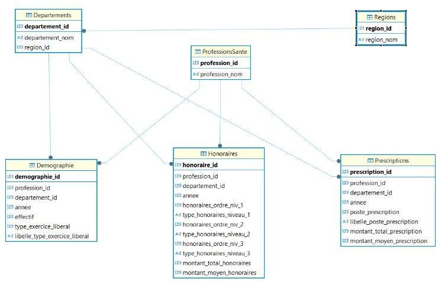

# Data Ameli · Base de données SQLite

Ce projet consiste à structurer les données agrégées de l’Assurance Maladie dans une base relationnelle SQLite. Il rassemble les prescriptions, les honoraires et la démographie des professions de santé afin de les analyser par profession, territoire et année, sur la période **2010 à 2023**.

## Aperçu de la base

### Modèle relationnel

[](docs/schema-base-ameli.jpeg)

Schéma de conception issu du rapport du projet. Il montre les relations entre les six tables. Les noms de certaines colonnes ont évolué dans la base livrée ; [schema.sql](schema.sql) fournit la structure exacte de `dabase.db`.

## Tester la base en local

Préparer **Git LFS** et un client SQLite, par exemple **DBeaver** ou **DB Browser for SQLite**.

```sh
git lfs install
git clone https://github.com/Kajan94/database-amelie.git
cd database-amelie
git lfs pull
```

Ouvrir ensuite `dabase.db` dans le client SQLite. La base complète fait environ **278 Mo**. Si le fichier ne contient que quelques lignes de texte, il s’agit du pointeur Git LFS : vérifier que `git lfs pull` a bien récupéré les données.

Les requêtes de [explorer.sql](explorer.sql) peuvent être ouvertes dans l’éditeur SQL du client et exécutées sur cette base. Avec le client en ligne de commande `sqlite3` :

```sh
sqlite3 -readonly -header -column dabase.db ".read explorer.sql"
```

Ces requêtes permettent de vérifier la période couverte, de contrôler la correspondance entre départements et régions et de comparer les montants régionaux des prescriptions en 2023. Le classement renvoie **18 régions**, dont **7 814 970 581 €** pour l’Île-de-France.

## Conception et contenu

Les fichiers CSV de Data ameli ont été analysés puis intégrés dans SQLite avec DBeaver. Trois référentiels, `Regions`, `Departements` et `ProfessionsSante`, sont reliés aux tables de données par des clés étrangères :

- `Prescriptions` : **390 960 lignes**, avec les postes et montants des prescriptions.
- `Honoraires` : **1 182 720 lignes**, avec les catégories et montants d’honoraires.
- `Demographie` : **123 840 lignes**, avec les effectifs par profession et mode d’exercice.

Chacune de ces trois tables couvre **2010 à 2023**. Les niveaux national, régional et départemental coexistent : les requêtes doivent choisir un périmètre précis pour éviter de compter plusieurs fois les mêmes agrégats.

Le dépôt contient également `Rapport.pdf`, qui décrit la démarche de conception, et `schema.sql`, qui permet de recréer les six tables dans une base vide. Ce dernier ne contient ni les données ni un script d’import des CSV.

### Contrôle des données

Le contrôle d’intégrité SQLite retourne `ok`. Le contrôle des clés étrangères signale toutefois une référence du fichier d’origine : le département `999`, « Tout département », est associé à la région `999`, absente de `Regions`. Cette particularité est conservée et documentée.

[Source des données : Cnam, Data ameli](https://data.ameli.fr/)

[Projet dans le portfolio](https://kajan94.github.io/Portefolio/#ameli)

## Travail en équipe

Projet universitaire réalisé à six en BUT Informatique à l’IUT de Créteil-Vitry (UPEC). J’ai assuré le rôle de chef de projet et participé à l’organisation et à la répartition du travail. L’équipe a travaillé sur l’analyse des fichiers sources, la modélisation relationnelle, l’intégration des données et les requêtes de vérification.
