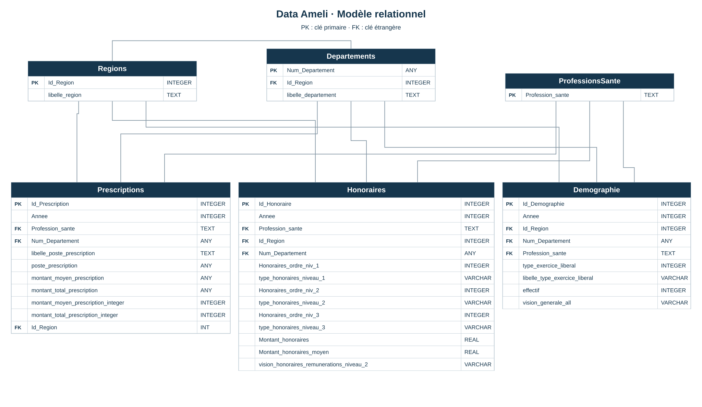

# Data Ameli · Base de données SQLite

Ce projet consiste à structurer les données agrégées de l’Assurance Maladie dans une base relationnelle SQLite. Il rassemble les prescriptions, les honoraires et la démographie des professions de santé afin de les analyser par profession, territoire et année, sur la période **2010 à 2023**.

## Aperçu de la base

### Modèle relationnel

[](modele-relationnel.svg)

Le modèle relie les référentiels géographiques et les professions de santé aux données de prescriptions, d’honoraires et de démographie. Il présente les six tables, leurs colonnes et leurs liens.

## Tester la base en local

1. Ouvrir le fichier [dabase.db](dabase.db) sur GitHub pour le télécharger. La base complète fait d’environ **278 Mo**.
2. Dans DBeaver ou un autre client SQLite, créer une nouvelle connexion, choisir **SQLite** et sélectionner le fichier téléchargé dans le champ **Chemin / Path**.
3. Tester la connexion, puis cliquer sur **Terminer**.

## Requêtes pour tester la base

Dans l’outil choisi, ouvrir un éditeur SQL ou une console reliée au fichier `dabase.db`, puis copier et exécuter les requêtes ci-dessous une par une.

### Voir les tables disponibles

```sql
SELECT name AS table_disponible
FROM sqlite_master
WHERE type = 'table'
ORDER BY name;
```

La liste doit contenir `Regions`, `Departements`, `ProfessionsSante`, `Prescriptions`, `Honoraires` et `Demographie`.

### Vérifier les années des prescriptions

```sql
SELECT MIN(Annee) AS premiere_annee,
       MAX(Annee) AS derniere_annee
FROM Prescriptions;
```

Résultat attendu : **2010** et **2023**.

### Comparer les prescriptions par région en 2023

```sql
SELECT r.libelle_region AS region,
       p.montant_total_prescription_integer AS montant_euros
FROM Prescriptions AS p
JOIN Regions AS r ON r.Id_Region = p.Id_Region
WHERE p.Annee = 2023
  AND p.Num_Departement = 999
  AND p.Profession_sante = 'Ensemble des médecins'
  AND p.poste_prescription = 'total'
  AND r.Id_Region <> 99
  AND typeof(p.montant_total_prescription_integer) = 'integer'
ORDER BY montant_euros DESC;
```

Le classement présente **18 régions**, dont **7 814 970 581 €** pour l’Île-de-France. Les filtres choisissent un total régional pour un même périmètre de prescriptions.

## Conception et contenu

Les fichiers CSV de Data ameli ont été analysés puis intégrés dans SQLite avec DBeaver. Trois référentiels, `Regions`, `Departements` et `ProfessionsSante`, sont reliés aux tables de données par des clés étrangères :

- `Prescriptions` : postes et montants des prescriptions.
- `Honoraires` : catégories et montants d’honoraires.
- `Demographie` : effectifs par profession et mode d’exercice.

Chacune de ces trois tables couvre **2010 à 2023**. Les niveaux national, régional et départemental coexistent : les requêtes doivent choisir un périmètre précis pour éviter de compter plusieurs fois les mêmes agrégats.

La base SQLite complète est fournie dans `dabase.db` via Git LFS. Elle contient déjà les données : aucune création de tables ni import CSV n’est nécessaire pour l’explorer.

[Source des données Ameli](https://data.ameli.fr/)

## Travail en équipe

Projet universitaire réalisé à six en BUT Informatique à l’IUT de Créteil-Vitry (UPEC). J’ai assuré le rôle de chef de projet et participé à l’organisation et à la répartition du travail. L’équipe a travaillé sur l’analyse des fichiers sources, la modélisation relationnelle, l’intégration des données et les requêtes de vérification.
